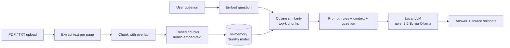

# Mini RAG Document Q&A

A small, free, fully local web app for asking questions about your PDF and TXT files.
It uses **Streamlit**, **Ollama** (local LLM and embeddings), and **NumPy** cosine
similarity. No API keys, no paid services, and your documents never leave your computer.

## Key features

- Upload PDF and TXT documents (up to 10 MB each)
- Text extraction, overlapping chunking, and local embeddings
- Retrieval with plain cosine similarity (NumPy, no vector database)
- Answers generated by a local model (`qwen2.5:3b`) from retrieved context only
- Source snippets with filename and page number (PDFs)
- Friendly errors for: Ollama not running, missing model, empty or scanned PDF, failed requests
- Small unit-test suite (no model download needed)

## Architecture



## RAG workflow

1. **Document extraction**: text is read from each PDF page or TXT file.
2. **Chunking**: ~800-character chunks with a 100-character overlap; each chunk keeps its filename and page number.
3. **Embeddings**: each chunk becomes a vector locally via `nomic-embed-text`.
4. **Retrieval**: the question is embedded and compared with all chunks by cosine similarity; the top 4 are kept.
5. **Context-grounded generation**: chunks and question go into a prompt that tells the model to answer only from the context.

## Prerequisites

- Python 3.10 or newer
- [Ollama](https://ollama.com/download) installed and running

## Setup (Windows, PowerShell)

```powershell
cd mini-rag-document-qa
python -m venv .venv
.venv\Scripts\Activate.ps1
pip install -r requirements.txt

ollama pull qwen2.5:3b
ollama pull nomic-embed-text
```

**macOS / Linux:** same steps, but activate with `source .venv/bin/activate`. Not verified on macOS or Linux.

## Run the app

```powershell
streamlit run app.py
```

## Run the tests

```powershell
python -m pytest -v
```

## Try it with the sample document

Upload `sample_docs/sample.txt` and try:

- How long can I borrow a book?
- What is the late fee, and is there a maximum?
- How many people fit in a study room?
- *(not in the document)* Who is the mayor of Riverbend? The app should say it cannot find sufficient evidence.

### Example output (illustrative only, not a verified benchmark)

> **Q:** How long can I borrow a book?
> **A:** Books are lent for 21 days, and can be renewed twice if nobody else has reserved them [1].

## Limitations

- Grounded prompting **reduces** unsupported answers but **cannot eliminate hallucinations**. Check the sources.
- `MIN_SCORE` is a simple, untuned heuristic, not a calibrated confidence score.
- No OCR for scanned PDFs; no persistent index.
- Small local models can miss details.

## Why this is RAG and not just a chatbot

A plain chatbot answers from what the model memorised. This app first **retrieves** passages
from *your* documents, **augments** the prompt with them, then **generates** an answer that can
be traced back to specific snippets.
